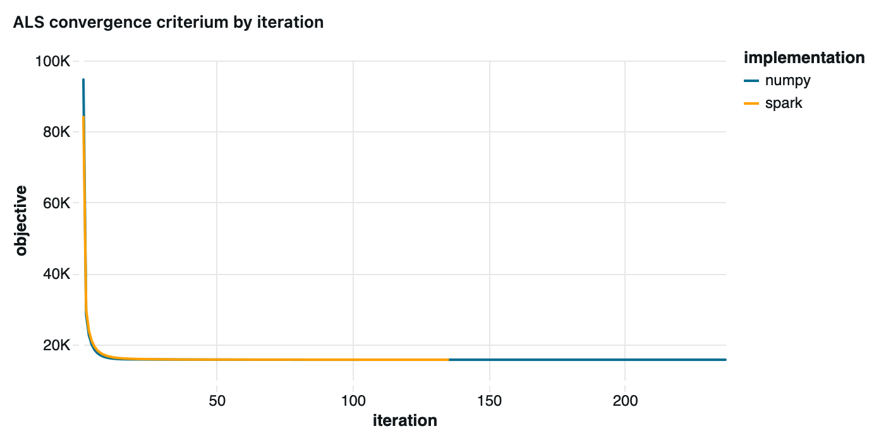

# Movie Rating Prediction with Alternating Least Squares (ALS)

**Personal project · Python · PySpark · Databricks**

## Overview

How can we predict which films a user might enjoy when most users have rated only a small fraction of the available films?

This project explores that question using **Alternating Least Squares (ALS)**, a mathematical method for learning patterns from incomplete rating data. The model identifies latent characteristics of users and films from existing ratings and uses them to estimate ratings that are not yet known.

The project combines a custom implementation of ALS with validation against Spark MLlib. A Databricks dashboard provides a visual view of model convergence and predicted versus actual ratings.

## How it works

Imagine a table with users in the rows, films in the columns and ratings in the cells. Most cells are empty because no rating has been recorded for most user–film combinations.

ALS learns a compact numerical profile for each user and each film. These profiles capture patterns in the observed ratings. A predicted rating is calculated by comparing the two profiles.

The model alternates between two steps:

1. Estimate user profiles while keeping film profiles fixed.
2. Estimate film profiles while keeping user profiles fixed.

These steps are repeated until the model's objective function stabilises.

The resulting model can estimate ratings for user–film combinations that were not present in the training data.

## Implementation and validation

The project develops and compares two custom implementations of Alternating Least Squares (ALS): one using NumPy and another using PySpark and Apache Spark for distributed computation.
The comparison focuses on the mathematical formulation, the alternating factor updates and the resulting predictions, using comparable model configurations and evaluation data.

The purpose is to validate the implementation and understand its behaviour, rather than to benchmark execution speed. Distributed computing introduces overhead, and its benefits depend on the size of the dataset and the computational workload.

## Results

The current implementation produces the following results.

### Validation results per implementation

The two custom ALS implementations were evaluated on the same validation dataset.

| Implementation | Number of ratings | RMSE | Mean predicted rating | Mean actual rating |
|---|---:|---:|---:|---:|
| NumPy | 1,890 | 1.32 | 3.19 | 3.66 |
| Spark | 1,890 | 1.28 | 3.21 | 3.66 |

**Interpretation**

- **Predictive accuracy:** The Spark implementation achieves a slightly lower RMSE (1.28 versus 1.32), indicating somewhat smaller prediction errors on this validation dataset.
- **Prediction bias:** Both implementations predict a lower average rating than the observed mean of 3.66. The mean predictions are 3.19 for NumPy and 3.21 for Spark.
- **Consistency:** Both implementations were evaluated on the same ratings, making their validation results directly comparable.

The results show broadly similar predictive performance, with a modest advantage for Spark. This comparison concerns predictive accuracy, not execution speed.

### Evaluating prediction accuracy

Root Mean Squared Error (RMSE) measures the magnitude of prediction errors, giving greater weight to larger errors. Lower values indicate better predictive accuracy.

## Visualising model behaviour

The Databricks dashboard examines two aspects of the model.

### Convergence

The convergence plot tracks the training objective over successive iterations. It helps assess whether the optimisation is progressing and approaching a stable solution.

### Predicted versus actual ratings

Comparing predictions with observed ratings helps reveal the accuracy of the model and identify cases where predictions differ substantially from actual ratings.

Together, these visualisations connect the optimisation process to the model's predictive performance.

## Possible extension: quantifying prediction uncertainty

The current model produces a single predicted rating for each user–film pair. However, a prediction alone does not indicate how reliable it is.

A possible extension is Bayesian matrix factorisation, which estimates probability distributions for the latent factors and resulting predictions rather than single values alone. This would make it possible to construct credible intervals and distinguish predictions supported by stronger evidence from those with greater uncertainty.

A relevant reference is Salakhutdinov and Mnih (2008), *Probabilistic Matrix Factorization*.

## Mathematical formulation

### Matrix factorisation

Let \(R\) be the user–movie rating matrix. Most entries are unknown because users rate only a small fraction of the available movies.

ALS approximates this matrix as the product of two lower-dimensional matrices:

$$
R \approx P Q^\top
$$

Here, \(P\) contains a numerical profile for each user, and \(Q\) contains a numerical profile for each movie. Each profile is a vector of \(k\) latent factors that capture patterns in the observed ratings.

The predicted rating for user \(u\) and movie \(i\) is the dot product of their profiles:

$$
\hat{r}_{ui} = p_u^\top q_i
$$

### Objective function

The model learns these profiles by minimising the squared differences between predicted and observed ratings, with a regularisation term to discourage excessively large factor values:

$$
\min_{P,Q}
\sum_{(u,i)\in\Omega}
(r_{ui}-p_u^\top q_i)^2
+
\lambda\left(
\sum_u \|p_u\|^2
+
\sum_i \|q_i\|^2
\right)
$$

where:

- \(\Omega\) is the set of observed user–movie ratings.
- \(r_{ui}\) is an observed rating, and \(\hat{r}_{ui}\) is its prediction.
- \(\lambda\) is a fixed regularisation parameter used throughout the optimisation. It controls the trade-off between fitting the observed ratings and keeping the latent-factor values small.

Only observed ratings contribute to the fitting error; unknown ratings are not treated as zero.

### Alternating optimisation

Rather than optimising both factor matrices simultaneously, ALS alternates between two steps:

1. **Update user factors:** hold the movie factors \(Q\) fixed and estimate the user factors \(P\).
2. **Update movie factors:** hold the user factors \(P\) fixed and estimate the movie factors \(Q\).

Each step reduces to a collection of regularised least-squares problems. The process repeats until the objective stabilises or a stopping criterion is reached.

## Technologies

- Python and NumPy for numerical computation
- PySpark and Apache Spark MLlib for distributed processing and model comparison
- Databricks for the development environment and visualisation

## Dataset and sources

### Dataset: Kaggle

The project uses the [MovieLens dataset published on Kaggle](https://www.kaggle.com/datasets/sherinclaudia/movielens).

MovieLens helps users discover films they may enjoy by building a taste profile from their ratings and recommending other films.

The dataset contains 1,000,209 anonymous ratings of approximately 3,900 films, provided by 6,040 MovieLens users who joined in 2000.

The ratings are stored in `ratings.dat`, with the following fields:

- `UserID`: user identifier, ranging from 1 to 6,040.
- `MovieID`: film identifier, ranging from 1 to 3,952.
- `Rating`: rating on a five-star scale, using whole-star values.
- `Timestamp`: time of the rating, represented as seconds since the Unix epoch.

Each user has rated at least 20 films.

### Original source and usage conditions: GroupLens Research

The original source is the [GroupLens Research MovieLens datasets page](https://grouplens.org/datasets/movielens/). The dataset originates from the GroupLens Research Group at the University of Minnesota.

The data providers do not guarantee the correctness of the data, its suitability for a particular purpose, or the validity of results based on its use.

Use of the dataset for research purposes is subject to the following conditions:

- Acknowledge the dataset in publications resulting from its use.
- Do not state or imply endorsement by the University of Minnesota or the GroupLens Research Group.
- Do not redistribute the data without separate permission.
- Obtain prior permission from a faculty member of the GroupLens Research Project for commercial or revenue-generating use.

The original data files are not redistributed with this project.
